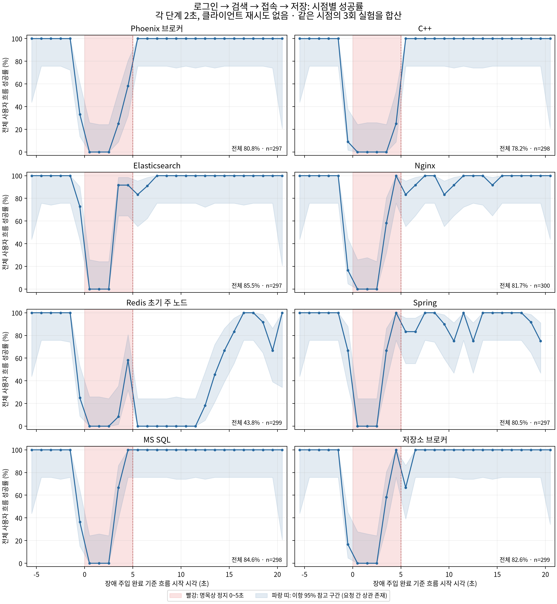

# 사용자 흐름의 카오스 성공률 실측 — 2026-10-16

장애 실험에 포함된 유효 사용자 흐름 **1,841/2,385 = 77.19%**가 제한 시간 안에 성공했습니다.
별도로 측정한 무장애 대조군은 **40/40 = 100%**입니다. 의도적으로 장애를 빈번하게 주입한
실험 평균이므로 운영 가용률이나 SLA로 환산할 수 없습니다.

- 실행 시간: 2026-10-16 00:03:02 ~ 00:16:43 KST.
- 실제 앱 이미지로 만든 격리 배포: Nginx → Spring / Phoenix → C++ → 저장소 브로커 → SQL·ES·Redis.
- 새 SQL·ES·Redis 데이터 볼륨, Redis 복제본 2개와 Sentinel 3개, 전용 internal 네트워크.
- 기존 인증서·설정은 읽기 전용으로 참조했습니다. 운영 데이터 볼륨은 연결하지 않았고 외부 포트도 게시하지 않았습니다.
- 로그인·검색·접속·저장은 실제 서비스 경로를 실행합니다. FE 화면 렌더링·사용자 입력 시간은 측정하지 않습니다.

## 성공 기준과 실험 설계

한 흐름은 아래 네 단계가 모두 성공해야 합니다.

1. 올바른 시험 계정의 로그인 요청이 정상 토큰을 반환.
2. 인증된 검색 결과에 시험 캔버스가 포함.
3. 캔버스 접근 토큰을 발급받고 WSS의 첫 `init_items`를 수신. 프로토콜과 클라이언트 ID 일치 확인.
4. 고유 객체의 유효한 `canvas_ops`가 C++ 저장 성공 응답과 해당 객체를 포함한 `canvas_commit`을 모두 수신.

**각 단계 제한 시간은 2,000ms**입니다. 접속은 접근 API와 WSS 스냅샷 수신을 합친 시간입니다.
저장은 응답과 확정 변경 수신을 합친 시간입니다. 단순 TCP 연결이나 HTTP 200만으로 저장 성공을 판단하지 않습니다.
클라이언트는 재시도하지 않으며 서버의 기존 재시도 동작은 그대로 포함합니다. 측정기의 타이머 처리 지연으로
2,001ms·2,004ms에 완료된 2건은 원시 기록의 완료 여부와 별개로 분석에서 제한 시간 초과 실패로 재분류했습니다.

8개 대상마다 5초 `docker pause` 후 복원하는 실험을 3회, 총 24회 수행했습니다.
주입 완료부터 복원 완료까지 실제 구간은 5.045~5.167초였습니다.
대상 순서는 seed `20261015`로 반복마다 섞었습니다. 한 번에 하나의 컨테이너만 정지했습니다.
각 실험은 장애 전 5초, 장애 약 5초, 복구 후 15초 동안 초당 약 4개의 새 흐름을 시작합니다.
그 뒤 8초간 새 요청을 중단해 진행 중인 흐름을 수집했습니다. 요청을 기다린 뒤 다음 요청을 만드는 폐쇄형 부하는 아닙니다.
전체 장애 실험 뒤 별도의 무장애 40건을 같은 속도로 실행했습니다.

**시점과 구간은 흐름 시작 시각 기준**입니다. 장애 직전 시작했어도 후속 단계가 장애와 겹치면 실패할 수 있고,
장애 중 시작했어도 2초 제한 시간 안에 복구되어 성공할 수 있습니다. 따라서 아래 ‘장애 전’은 순수한 무장애 대조군과 다릅니다.

## 평균 성공 확률

각 시점의 추정치는 `p̂(t) = 그 1초 구간에서 시작한 성공 흐름 수 / 그 구간의 전체 시작 수`입니다.
평균은 표본 수로 가중합니다: `Σ 성공 / Σ 시도 = 1,841/2,385 = 77.19%`.
서로 다른 구간의 퍼센트를 단순 평균하지 않았습니다.

| 흐름 시작 구간 | 성공 / 시도 | 성공률 |
|---|---:|---:|
| 장애 전 | 433 / 493 | 87.83% |
| 정지 중 | 129 / 478 | 26.99% |
| 복원 후 15초 | 1,279 / 1,414 | 90.45% |
| 장애 실험 전체 | 1,841 / 2,385 | **77.19%** |
| 별도 무장애 대조군 | 40 / 40 | 100.00% |

## 장애 대상별 전체 흐름

각 행은 해당 컨테이너를 정지한 3회 실험의 관측치입니다. 마지막 열에는 장애 전·정지 중·복구 후의
모든 흐름이 포함됩니다. 단일 구성 요소 자체의 독립적인 가용 확률을 뜻하지 않습니다.

| 정지 대상 | 장애 전 | 정지 중 | 복원 후 15초 | 전체 성공 / 시도 | 전체 성공률 |
|---|---:|---:|---:|---:|---:|
| Nginx | 84.13% | 36.67% | 96.05% | 245 / 300 | 81.67% |
| Spring | 95.00% | 35.48% | 91.43% | 239 / 297 | 80.47% |
| Phoenix 브로커 | 86.89% | 16.95% | 100.00% | 240 / 297 | 80.81% |
| C++ | 83.87% | 6.78% | 100.00% | 233 / 298 | 78.19% |
| 저장소 브로커 | 84.13% | 33.90% | 98.31% | 247 / 299 | 82.61% |
| MS SQL | 88.52% | 35.00% | 100.00% | 252 / 298 | 84.56% |
| Elasticsearch | 95.08% | 37.29% | 98.31% | 254 / 297 | 85.52% |
| Redis 초기 주 노드 | 85.48% | 13.33% | 39.55% | 131 / 299 | 43.81% |

Redis 초기 주 노드의 정지 실험에서 복원 이후 접속 제한 시간 초과가 많이 남았습니다.
Sentinel 설정의 장애 판정 시간은 5초로 이번 정지 시간과 겹칩니다. 역할 전환·연결 재탐색이 영향을
주었을 가능성은 있지만, 이번 기록에는 `ROLE`·Sentinel 선출 로그가 없으므로 원인을 확정하지 않습니다.
정지 대상은 처음 주 노드였던 **동일 컨테이너**로 고정했습니다. 후속 반복에서도 실제 주 노드였다고 단정하지 않습니다.
다음 개선 검증에서는 각 반복 직전 현재 주 노드를 확인하고 역할·연결 풀·선출 시각을 함께 기록해야 합니다.

## 시점별 확률

[전체 그래프 PDF](chaos-userflow-2026-10-16/chaos-userflow-timeline.pdf) ·
[PNG](chaos-userflow-2026-10-16/chaos-userflow-timeline.png) ·
[대상별 1초 전체 CSV](chaos-userflow-2026-10-16/timeline.csv).



아래는 8개 대상을 합산한 시점별 관측치입니다. `t=0`은 정지 주입 완료이고 약 `t=5`에 복원합니다.
처음·마지막 구간은 관측 시간이 짧아 표본 수가 작습니다. 각 대상별 값은 CSV에 모두 포함했습니다.

| 흐름 시작 구간 t (초) | 성공 / 시도 | 추정 성공률 |
|---|---:|---:|
| [-6, -5) | 24 / 24 | 100.00% |
| [-5, -4) | 96 / 96 | 100.00% |
| [-4, -3) | 95 / 95 | 100.00% |
| [-3, -2) | 95 / 95 | 100.00% |
| [-2, -1) | 93 / 93 | 100.00% |
| [-1, 0) | 30 / 90 | 33.33% |
| [0, 1) | 0 / 90 | 0.00% |
| [1, 2) | 0 / 90 | 0.00% |
| [2, 3) | 0 / 95 | 0.00% |
| [3, 4) | 45 / 96 | 46.88% |
| [4, 5) | 76 / 96 | 79.17% |
| [5, 6) | 74 / 96 | 77.08% |
| [6, 7) | 79 / 95 | 83.16% |
| [7, 8) | 84 / 96 | 87.50% |
| [8, 9) | 83 / 95 | 87.37% |
| [9, 10) | 77 / 91 | 84.62% |
| [10, 11) | 78 / 94 | 82.98% |
| [11, 12) | 80 / 92 | 86.96% |
| [12, 13) | 78 / 90 | 86.67% |
| [13, 14) | 86 / 92 | 93.48% |
| [14, 15) | 90 / 95 | 94.74% |
| [15, 16) | 94 / 96 | 97.92% |
| [16, 17) | 95 / 95 | 100.00% |
| [17, 18) | 96 / 96 | 100.00% |
| [18, 19) | 94 / 96 | 97.92% |
| [19, 20) | 88 / 95 | 92.63% |
| [20, 21) | 11 / 11 | 100.00% |

## 단계별 요청의 성공률

단계별 분모는 그 단계가 실제 실행된 요청입니다. 앞 단계 실패로 후속 단계를 실행하지 못한 흐름은
후속 단계의 분모에 포함되지 않습니다. 따라서 단계별 수치만으로 전체 성공률을 대신할 수 없습니다.
원시 실행이 제한 시간을 몇 ms 초과한 뒤에도 후속 단계를 실행한 2건이 있어 접속의 적시 성공 수와
저장 시도 수가 정확히 이어지지는 않습니다. 전체 흐름에서는 두 건 모두 실패입니다.

| 단계 | 제한 시간 내 성공 / 실제 실행 | 성공률 |
|---|---:|---:|
| 로그인 | 2,203 / 2,385 | 92.37% |
| 검색 | 2,163 / 2,203 | 98.18% |
| 접속 | 1,846 / 2,163 | 85.34% |
| 저장 | 1,843 / 1,848 | 99.73% |

실제 실행된 단계 요청을 합친 평균은 **8,055/8,599 = 93.67%**입니다.
사용자가 선택한 전체 흐름의 평균 **77.19%**와는 분모와 의미가 다릅니다.

## 저장 검증과 한계

새로운 WSS 접속으로 최종 스냅샷을 읽어 성공 완료 기록의 모든 ID와 객체 본문을 검사했습니다.
원시 완료 기록 1,884건(장애 실험 완료 1,843건 + 대조군 40건 + 사전 검증 1건)은
**누락 0건·본문 불일치 0건**이었습니다. 이 중 2건은 위 2초 기준에서 실패 처리한 지연 완료입니다.
추가로 응답 대기에서 시간 초과한 5건도 실제 저장되어 최종 객체는 1,889개였습니다.
시간 초과를 곧바로 저장 실패·데이터 유실로 해석하면 안 됩니다.
이 확인은 복제본·디스크 동기 쓰기 완료나 전원 차단 내구성을 보장하지 않습니다.

- 각 장애는 3회뿐입니다. 같은 정지 구간의 요청들은 상관되어 있어 수천 건을 독립적인 장애 수천 회로 해석할 수 없습니다.
- JSON·그래프의 Wilson 95% 구간은 이항 표본 모델의 참고 구간입니다. 상관된 요청과 적은 장애 반복 수 때문에 엄밀한 실서비스 신뢰구간이 아닙니다.
- 반복마다 앱·DB를 초기화하지 않고 같은 격리 배포를 사용했습니다. 앞선 장애의 연결·부하 잔여 효과와 데이터 증가가 후속 실험에 영향을 줄 수 있습니다.
- 이름 기반 검색만 검증했습니다. 격리 배포의 의미 검색은 비활성화했고 임베딩 서비스는 복제하지 않았습니다.
- SQL 초기화에는 저장소 스키마를, ES에는 실험용 인덱스와 역할을 사용했습니다. 운영 ES의 모든 검색 설정·로그 정책을 복제한 결과는 아닙니다.
- 같은 호스트의 내부 TLS 경로입니다. 사용자 인터넷 회선·브라우저 UI·다중 호스트·네트워크 단절·SIGKILL·디스크 장애·동시 다중 장애는 포함하지 않습니다.
- 평균은 이번에 정한 장애 대상 비율과 5초/5초/15초 관측 비율에만 해당합니다. 운영 장애 빈도나 연간 가용률을 추정하지 않습니다.
- 24개 저널 모두 `restored`입니다. 실험 컨테이너·데이터 볼륨·네트워크와 자격 증명 파일은 제거됐습니다. 운영 서비스에는 장애를 주입하지 않았습니다.

## 자료와 재실행

- [분석 JSON](chaos-userflow-2026-10-16/summary.json), [원시 요청 JSONL gzip](chaos-userflow-2026-10-16/requests.jsonl.gz), [요청별 CSV](chaos-userflow-2026-10-16/requests.csv).
- [장애 시각](chaos-userflow-2026-10-16/events.json), [이미지·조건](chaos-userflow-2026-10-16/manifest.json), [최종 저장 검증](chaos-userflow-2026-10-16/audit.json).
- 생성기: `tests/chaos_userflow_lab.py`, `tests/chaos_userflow_worker.mjs`.
- 집계: `tests/summarize_chaos_userflow.py`, 그림: `tests/plot_chaos_userflow.py` (Matplotlib 필요).

```sh
python3 tests/chaos_userflow_lab.py --rounds 3
python3 tests/summarize_chaos_userflow.py results/orchestra-chaos-flow-<실행 ID>
python3 tests/plot_chaos_userflow.py results/orchestra-chaos-flow-<실행 ID> docs/chaos-userflow-<날짜>
```

시험 배포는 실행 중인 Agora 컨테이너에서 이미지·설정·읽기 전용 인증서만 참조합니다.
대상·네트워크·볼륨은 매번 고유 이름으로 새로 만들고 Orchestra의 라벨·네트워크 허용 목록으로 장애를 제한합니다.
재실행 결과는 현재 이미지와 호스트 부하에 따라 달라질 수 있습니다. Orchestra 기존 테스트 34개도 통과했습니다.
